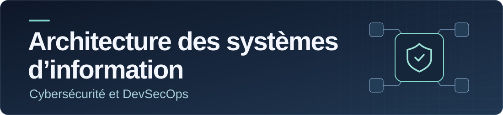

  

Je développe des interfaces web, des API et des outils en ligne de commande.

  

## Langages

## Frameworks et outils

## Projets à découvrir

| Projet | Aperçu |
| --- | --- |
| **Chrono Explorer** [Interface](https://github.com/AdlalKheraz/Frontend-CE) · [API](https://github.com/AdlalKheraz/Backend-CE) | Application d’exploration d’événements historiques avec une interface Angular et une API Java organisée en microservices. |
| **[Fresh Rescue](https://github.com/AdlalKheraz/Fresh-Rescue)** | Prototype anti-gaspillage alimentaire avec catalogue et retrait en magasin, réalisé avec Next.js et TypeScript. |
| **[Crawlia](https://github.com/AdlalKheraz/Crawlia)** | Outil Node.js qui mesure le temps de réponse d’une page web, vérifie ses balises SEO et repère les liens cassés. |
